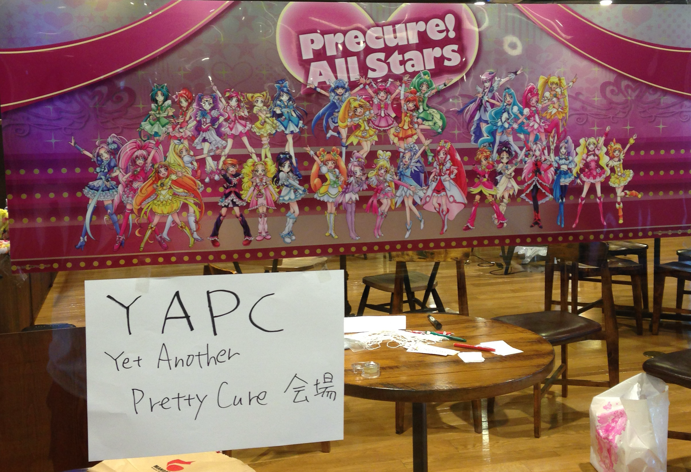

# Yet Another Pretty Cure - All about of rubicure

2026/11/20 [YAPC::Tokyo 2026 非公式予習会](https://smartbank.connpass.com/event/411450/) #yapcjapan_yoshu

[@sue445](https://x.com/sue445)

https://sue445.github.io/slide-20261120-yapcjapan-yoshu/

---
##  自己紹介
* [@sue445](https://x.com/sue445)
* ピクシブ株式会社
* クラウドネイティブ分野のシニアテックリード
  * AWS, Google Cloud, Kubernetes
* 今年YAPC初参加

---
## 2015/08/22 [プリキュアハッカソン 3](https://cure-hack.connpass.com/event/17280/)


---
## 今日話すこと
* rubicureの紹介(YAPCのLTに落ちた話の供養)

---
## rubicureについて
* https://github.com/sue445/rubicure
* プリキュアのRuby実装(sue445の代表作)
* 2013/12/15: v0.0.1 🎂
* 2026/11/05: v4.2.2 (Latest)
* 13年くらいメンテしてる

---
## 全部で124 tagsある
```bash
$ git tag | wc -l
     124
```

---
## Versioning Policy
* rubicure uses **Semantic Cure Versioning** ❤️
  * https://github.com/sue445/rubicure#versioning-policy
* 基本的には普通のSemantic Versioningと同じだが、新しいプリキュアシリーズの追加の時はMinor version upを行う

---
## 主要機能の紹介
* 実際に動くのを見てもらうのが早いと思うので見せます

---
## 現在のプリキュアを取得
<iframe class="playground" src="https://rubicure-playground-lczknh2o4a-an.a.run.app/play?readonly=false&editor_height=8em&font_size=24&input=Precure.now" />

## 発表スライドについて
* GitHub Pages: https://sue445.github.io/slide-20261120-yapcjapan-yoshu/
* reveal.js: https://revealjs.com/

---
## スライド内でRubyを動かしてるやつ
* https://github.com/sue445/rubicure-playground
  * Ruby
  * sinatra
  * Cloud Run
  * Ace Editor: https://ace.c9.io/
* スライド内のiframeで動かしている

---
## 仕組み
1. エディタに任意コードを入力してサーバサイド(Cloud Runのsinatra app)にPOST
2. POSTされたRubyのコードをsinatraで実行して、実行結果を標準出力をいい感じにキャプチャする
3. サーバサイドから返された結果をフロントエンドで1行ずつそれっぽく表示

---
## Q. ruby.wasmでいいのでは？
* A. ruby.wasmだと3rd party製のgemを使えないためサーバサイドで動かす方式をとった

---
## ここから先は時間の許す限りrubicureを動かすパート

---
## プリキュアのシリーズを取得
<iframe class="playground" src="https://rubicure-playground-lczknh2o4a-an.a.run.app/play?readonly=false&editor_height=8em&font_size=24&input=Precure.meitantei.title" />

---
## プリキュアがオンエア中か取得
<iframe class="playground" src="https://rubicure-playground-lczknh2o4a-an.a.run.app/play?readonly=false&editor_height=8em&font_size=24&input=Precure.meitantei.on_air%3F(%222026-11-20%22)" />

---
## プリキュアのシリーズに所属してるメンバーを取得
<iframe class="playground" src="https://rubicure-playground-lczknh2o4a-an.a.run.app/play?&readonly=false&editor_height=8em&font_size=24&input=Precure.meitantei.members.map(%26%3Ahuman_name)%0APrecure.meitantei.members.count%0A" />

---
## 特定のプリキュアを取得
<iframe class="playground" src="https://rubicure-playground-lczknh2o4a-an.a.run.app/play?readonly=false&editor_height=8em&font_size=24&input=Cure.answer.human_name%0ACure.answer.precure_name%0ACure.answer.birthday%0A" />

---
## そのナゾ！キュアット解決！
<iframe class="playground" src="https://rubicure-playground-lczknh2o4a-an.a.run.app/play?readonly=false&editor_height=8em&font_size=24&input=Cure.answer.name%0ACure.answer.transform!%0ACure.answer.name%0ACure.answer.attack!%0A" />

---
## トロプリは毎話名乗りがランダムなので再現
<iframe class="playground" src="https://rubicure-playground-lczknh2o4a-an.a.run.app/play?readonly=false&editor_height=8em&font_size=24&input=Cure.summer.transform!%0A" />

---
## レインボーパフュームいくニャン！
<iframe class="playground" src="https://rubicure-playground-lczknh2o4a-an.a.run.app/play?readonly=false&editor_height=8em&font_size=24&input=Cure.cosmo.transform!(%3Arainbow_perfume)" />

---
## フルネーム(キュアプリンセス)
<iframe class="playground" src="https://rubicure-playground-lczknh2o4a-an.a.run.app/play?readonly=false&editor_height=8em&font_size=24&input=Cure.princess.human_name%0ACure.princess.full_name%0A" />

---
## フルネーム(キュアスカーレット)
<iframe class="playground" src="https://rubicure-playground-lczknh2o4a-an.a.run.app/play?readonly=false&editor_height=8em&font_size=24&input=Cure.scarlet.human_name%0ACure.scarlet.full_name" />

---
## 全プリキュア（キュアエコー含む）
<iframe class="playground" src="https://rubicure-playground-lczknh2o4a-an.a.run.app/play?readonly=false&editor_height=8em&font_size=24&input=Precure.all_members.count%0A" />

---
## プリキュアオールスターズ（映画のやつ）
<iframe class="playground" src="https://rubicure-playground-lczknh2o4a-an.a.run.app/play?readonly=false&editor_height=8em&font_size=24&input=Precure.all_stars.count%0APrecure.all_stars(%222013-10-26%22).count%0APrecure.all_stars(%3Adx).count%0APrecure.all_stars(%3Adx2).count%0APrecure.all_stars(%3Adx3).count%0APrecure.all_stars(%3Anew_stage).count%0APrecure.all_stars(%3Anew_stage2).count%0APrecure.all_stars(%3Anew_stage3).count%0APrecure.all_stars(%3Aspring_carnival).count%0APrecure.all_stars(%3Asing_together_miracle_magic).count%0APrecure.all_stars(%3Amemories).count%0A" />

---
## オールスターズがつかない映画
<iframe class="playground" src="https://rubicure-playground-lczknh2o4a-an.a.run.app/play?readonly=false&editor_height=8em&font_size=24&input=Precure.dream_stars.map(%26%3Aprecure_name)%0APrecure.super_stars.map(%26%3Aprecure_name)%0APrecure.miracle_universe.map(%26%3Aprecure_name)%0APrecure.miracle_leap.map(%26%3Aprecure_name)%0A" />

---
## ピカリンじゃんけん
<iframe class="playground" src="https://rubicure-playground-lczknh2o4a-an.a.run.app/play?readonly=false&editor_height=8em&font_size=24&input=Cure.peace.pikarin_janken%3B%20nil" />

---
## Not operator（悪落ち）
<iframe class="playground" src="https://rubicure-playground-lczknh2o4a-an.a.run.app/play?readonly=false&editor_height=8em&font_size=24&input=Cure.passion.name%0A!Cure.passion%0ACure.passion.name%0A" />

---
## Not operator（悪落ち）
<iframe class="playground" src="https://rubicure-playground-lczknh2o4a-an.a.run.app/play?readonly=false&editor_height=8em&font_size=24&input=Cure.beat.name%0A!Cure.beat%0ACure.beat.name%0A" />

---
## Not operator（悪落ち）
<iframe class="playground" src="https://rubicure-playground-lczknh2o4a-an.a.run.app/play?readonly=false&editor_height=8em&font_size=24&input=Cure.scarlet.name%0A!Cure.scarlet%0ACure.scarlet.name%0A" />

---
## Not operator（悪落ち）
<iframe class="playground" src="https://rubicure-playground-lczknh2o4a-an.a.run.app/play?readonly=false&editor_height=8em&font_size=24&input=Cure.finale.name%0A!Cure.finale%0ACure.finale.name%0A" />

---
## Color methods
<iframe class="playground" src="https://rubicure-playground-lczknh2o4a-an.a.run.app/play?readonly=false&editor_height=8em&font_size=24&input=Rubicure%3A%3AGirl.colors%0APrecure.all_members.select(%26%3Apink%3F).map(%26%3Aprecure_name)%0APrecure.all_members.count(%26%3Apink%3F)" />

---
## Birthday methods
<iframe class="playground" src="https://rubicure-playground-lczknh2o4a-an.a.run.app/play?readonly=false&editor_height=8em&font_size=24&input=Precure.all_members.select(%26%3Ahave_birthday%3F).count%0APrecure.all_members.select(%26%3Ahave_birthday%3F).sort_by%20%7B%20%7Cgirl%7C%20Date.parse(girl.birthday)%20%7D.map%7B%20%7Cgirl%7C%20%5Bgirl.birthday%2C%20girl.human_name%5D%20%20%7D%0A" />

---
## 平成プリキュア vs 令和プリキュア
<iframe class="playground" src="https://rubicure-playground-lczknh2o4a-an.a.run.app/play?readonly=false&editor_height=8em&font_size=24&input=Cure.star.heisei%3F%0ACure.cosmo.reiwa%3F%0APrecure.all_members.count(%26%3Aheisei%3F)%0APrecure.all_members.count(%26%3Areiwa%3F)" />
